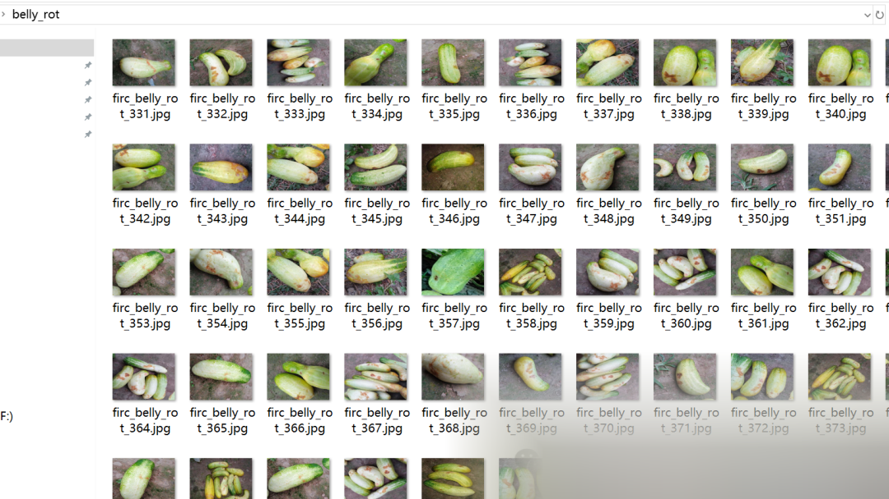
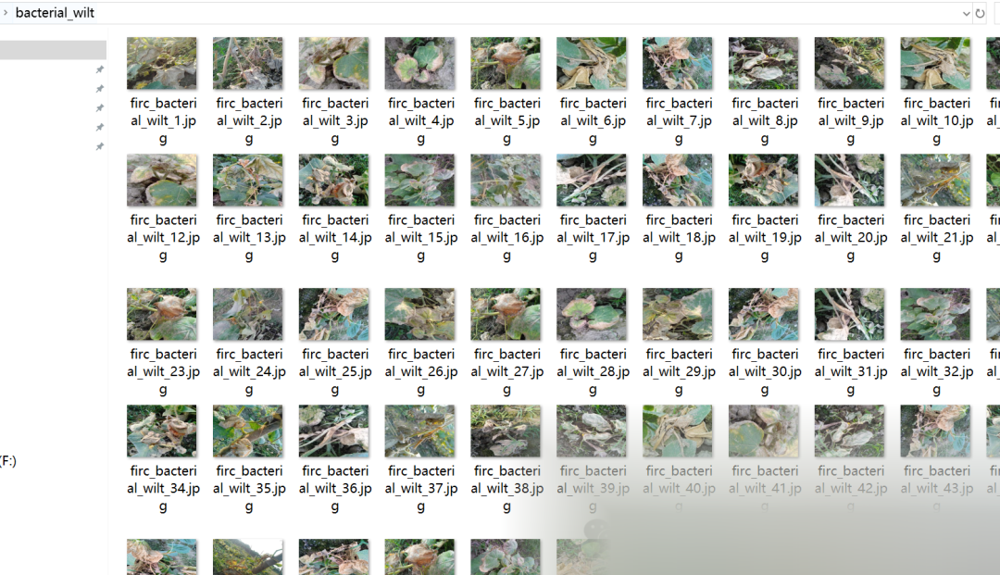

# Cucumber and its leaves disease classification dataset 6400 images in 8 categories

Dataset Type: Image Classification, Not for Object Detection Unlabeled Files
Dataset Format: Only contains jpg images, each category folder contains the corresponding image.
Number of Images (Number of jpg files): 6400
Number of Categories: 8
Category Names:

["anthracnose", "bacterial_wilt", "belly_rot", "downy_mildew", "fresh_cucumber", "fresh_leaf", "gummy_stem_blight", "pythium_fruit_rot"]
Each category image count:
anthracnose 800
bacterial_wilt 800
belly_rot 800
downy_mildew 800
fresh_cucumber 800
fresh_leaf 800
gummy_stem_blight 800
pythium_fruit_rot 800

Important Notice: No
Special Declaration: This dataset does not guarantee the accuracy of the trained models or weight files, and only provides accurate and reasonable classification storage.

Image Preview:

## Payment

Here is a pay link on Stripe ( https://buy.stripe.com/3cs8yP7sY87d0vu9AB ). Please contact me lonlonago@foxmail.com after funding $89, and I will send you a complete data files , thank you!

